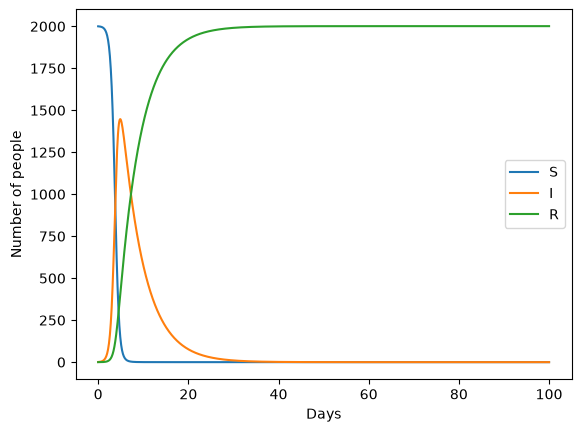
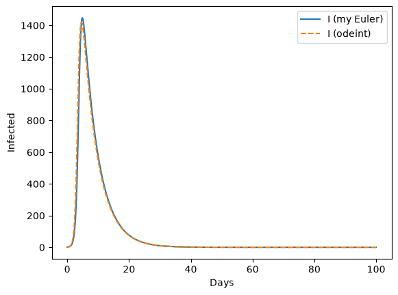
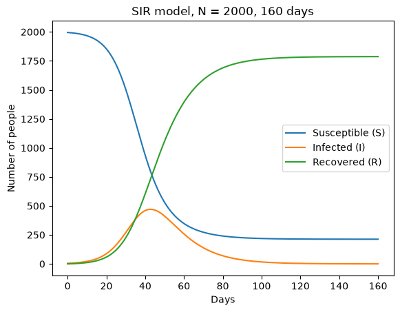
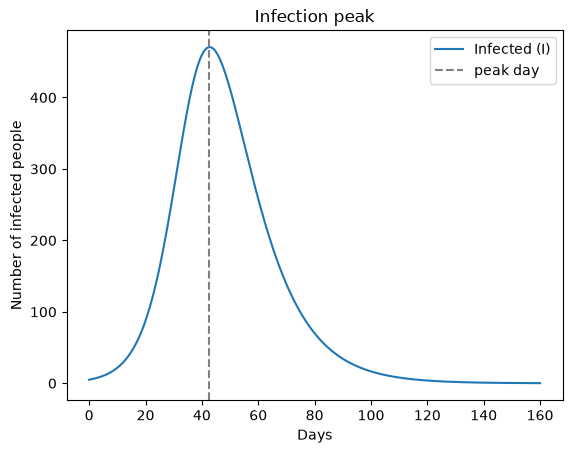

# Name: Peeyush Kumar Singh
# Email: peeyush.singh@emory.edu
# Question No: HW1
## Files
| File | What it does |
|---|---|
| `partA_hw1.ipynb` | SIR model function (forward Euler) + check against scipy odeint |
| `partB_hw1.ipynb` | SIR simulation for 160 days |
| `partC_hw1.ipynb` | Infection peak, R0, epidemic dynamics |
| `partD_hw1.ipynb` | SEIR model with births and deaths, epidemic waves |
| `partE_hw1.ipynb` | Sensitivity analysis on a grid of beta and gamma |
| `figures/` | All the plots |
| `requirements.txt` | Python packages needed |

# HW1 Part A - SIR Model Implementation
SIR equations:
- dS/dt = -beta * S * I
- dI/dt = beta * S * I - gamma * I
- dR/dt = gamma * I
I am using the forward Euler method to solve it:
new value = old value + dt * (derivative)
### Quick test

### Checking with a built-in solver
Comparing my Euler result with scipy's odeint.

# HW1 Part B - SIR Model Implementation with Values
SIR equations:
- dS/dt = -beta * S * I
- dI/dt = beta * S * I - gamma * I
- dR/dt = gamma * I
I am using the forward Euler method to solve it:
new value = old value + dt * (derivative)
### Simulation with Part B values

# HW1 Part C - Analysis and Interpretation
Using the same SIR model (forward Euler) and the Part B values.
## i. Infection peak

**Discussion:**
The number of infected people peaks around day 43 with about 470 people infected at the same time.
The peak happens when new infections per day equal recoveries per day:
beta * S * I = gamma * I  ->  S = gamma / beta = 800
Factors that decide the peak:
- **beta (transmission rate):** higher beta means faster spread, so the peak is higher and earlier.
- **gamma (recovery rate):** higher gamma means people recover faster, so fewer are sick at once and the peak is lower.
- **Starting number of susceptible people / population size:** more susceptible people means more people to infect, so a bigger peak.
- **Starting number of infected (I0):** more starting infected mostly makes the peak come earlier.
In my hypothesis I guessed the peak around day 35-40. The real peak is a bit later because the early growth slows down sooner than my simple doubling estimate assumed in hypothesis.
## ii. Basic reproduction number
**Discussion:**
R0 = (0.125e-3 * 2000) / 0.1 = 2.5
This means one infected person infects about 2.5 other people on average (when almost everyone is still susceptible). A sick person is sick for about 1/gamma = 10 days and infects about 0.25 people per day, so 0.25 * 10 = 2.5.
How R0 affects spread and control:
- If **R0 > 1**, each case leads to more than one new case, so the outbreak grows. Here R0 = 2.5 so we get a big outbreak.
- If **R0 < 1**, each case leads to less than one new case, so the disease dies out.
- A bigger R0 means a faster, larger outbreak and more people infected in total.
- To control the epidemic we need to bring R0 below 1. We can lower beta (social distancing, masks, isolation) or raise gamma (faster treatment). Vaccination also works by lowering the number of susceptible people.
- The outbreak stops growing when S drops below N/R0 = 800, which matches the peak in part i.
## iii. Epidemic dynamics

**Discussion:**
- **S (susceptible):** stays close to original population for the first ~20 days, then drops fast between day 20 and 60, and then levels off. It never goes to zero.
- **I (infected):** starts at 5, grows slowly at first, then quickly, peaks around day 42, then goes down to almost 0 by around day 120.
- **R (recovered):** starts at 0 and goes up like an S-shape, ending around 1785.
About 213 people (around 10.6%) are never infected by the end of the simulation.
How the compartments interact:
- People only move S -> I -> R. The total S + I + R stays 2000.
- New infections need both susceptible and infected people (the beta * S * I term). 
- As more people get infected, S gets smaller, so each sick person finds fewer people to infect.
- After S drops below 800, recoveries are faster than new infections, so I goes down.
- The outbreak ends because there are not enough infected people left to keep spreading it.

