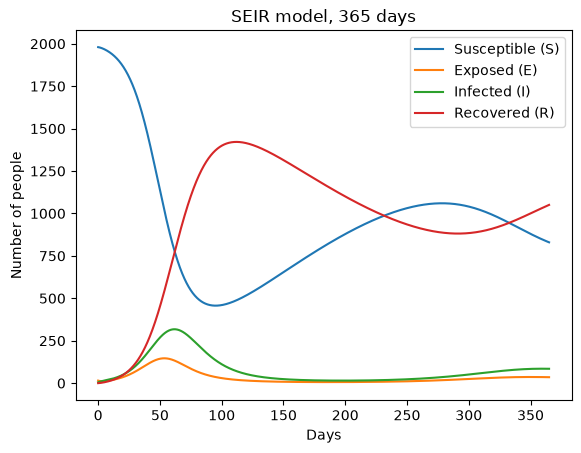
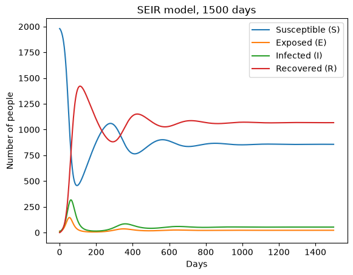
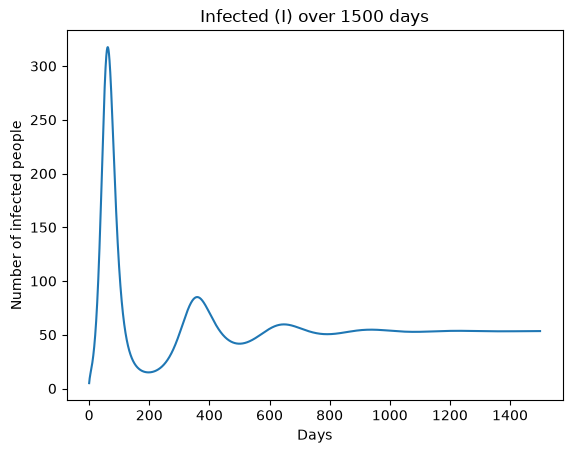
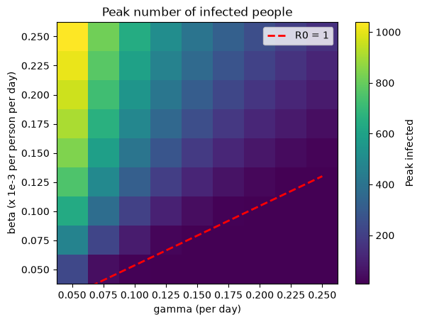
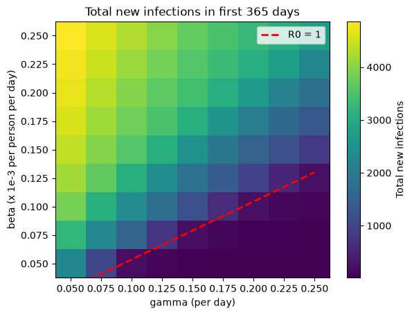

# Name: Peeyush Kumar Singh
# Email: peeyush.singh@emory.edu
# Question No: HW1
## Files
| File | What it does |
|---|---|
| `partA_hw1.ipynb` | SIR model function (forward Euler) + check against scipy odeint |
| `partB_hw1.ipynb` | SIR simulation for 160 days |
| `partC_hw1.ipynb` | Infection peak, R0, epidemic dynamics |
| `partD_hw1.ipynb` | SEIR model with births and deaths, epidemic waves |
| `partE_hw1.ipynb` | Sensitivity analysis on a grid of beta and gamma |
| `figures/` | All the plots |
| `requirements.txt` | Python packages needed |

# HW1 Part A - SIR Model Implementation

SIR equations:

- dS/dt = -beta * S * I
- dI/dt = beta * S * I - gamma * I
- dR/dt = gamma * I

I am using the forward Euler method to solve it:

new value = old value + dt * (derivative)

### Quick test

### Checking with a built-in solver

The assignment says we can use a built-in solver only to check. Comparing my Euler result with scipy's odeint.

---

# HW1 Part B - SIR Model Implementation with Values

SIR equations:

- dS/dt = -beta * S * I
- dI/dt = beta * S * I - gamma * I
- dR/dt = gamma * I

I am using the forward Euler method to solve it:

new value = old value + dt * (derivative)

### Simulation with Part B values

---

# HW1 Part C - Analysis and Interpretation

Using the same SIR model (forward Euler) and the Part B values.

## i. Infection peak

**Discussion:**

The number of infected people peaks around day 43 with about 470 people infected at the same time.

The peak happens when new infections per day equal recoveries per day:

beta * S * I = gamma * I  ->  S = gamma / beta = 800

Factors that decide the peak:
- **beta (transmission rate):** higher beta means faster spread, so the peak is higher and earlier.
- **gamma (recovery rate):** higher gamma means people recover faster, so fewer are sick at once and the peak is lower.
- **Starting number of susceptible people / population size:** more susceptible people means more people to infect, so a bigger peak.
- **Starting number of infected (I0):** more starting infected mostly makes the peak come earlier.

In my hypothesis I guessed the peak around day 35-40. The real peak is a bit later because the early growth slows down sooner than my simple doubling estimate assumed in hypothesis.

## ii. Basic reproduction number

**Discussion:**

R0 = (0.125e-3 * 2000) / 0.1 = 2.5

This means one infected person infects about 2.5 other people on average (when almost everyone is still susceptible). A sick person is sick for about 1/gamma = 10 days and infects about 0.25 people per day, so 0.25 * 10 = 2.5.

How R0 affects spread and control:
- If **R0 > 1**, each case leads to more than one new case, so the outbreak grows. Here R0 = 2.5 so we get a big outbreak.
- If **R0 < 1**, each case leads to less than one new case, so the disease dies out.
- A bigger R0 means a faster, larger outbreak and more people infected in total.
- To control the epidemic we need to bring R0 below 1. We can lower beta (social distancing, masks, isolation) or raise gamma (faster treatment). Vaccination also works by lowering the number of susceptible people.
- The outbreak stops growing when S drops below N/R0 = 800, which matches the peak in part i.

## iii. Epidemic dynamics

**Discussion:**

- **S (susceptible):** stays close to original population for the first ~20 days, then drops fast between day 20 and 60, and then levels off. It never goes to zero.
- **I (infected):** starts at 5, grows slowly at first, then quickly, peaks around day 42, then goes down to almost 0 by around day 120.
- **R (recovered):** starts at 0 and goes up like an S-shape, ending around 1785.

About 213 people (around 10.6%) are never infected by the end of the simulation.

How the compartments interact:
- People only move S -> I -> R. The total S + I + R stays 2000.
- New infections need both susceptible and infected people (the beta * S * I term). 
- As more people get infected, S gets smaller, so each sick person finds fewer people to infect.
- After S drops below 800, recoveries are faster than new infections, so I goes down.
- The outbreak ends because there are not enough infected people left to keep spreading it.

---

# HW1 Part D - SEIR Model with Births and Deaths

SEIR equations:

- dS/dt = mu*N - beta*S*I - mu*S
- dE/dt = beta*S*I - (sigma + mu)*E
- dI/dt = sigma*E - (gamma + mu)*I
- dR/dt = gamma*I - mu*R

E = exposed (infected but not infectious yet). 
I am using forward Euler again for solving this.

## i. SEIR function

## ii. Simulation for 365 days and 1500 days

## iii. Epidemic waves

Finding the peaks (waves) of I by checking where I is bigger than the points before and after it.

**Discussion:**

There are several waves, and each one is smaller than the one before:
- The first wave is the big one, like in the SIR model. After it, I drops to about 15 around day 197.
- The waves come about every 290 days.
- After the first wave the next ones are very small bumps, and I settles to a steady level of about 53 infected.

Why waves happen: after the first wave there are not many susceptible people left, so the infection goes down. But births keep adding new susceptible people. When there are enough of them again, the infection grows again and makes a new wave.

In my hypothesis, I expected multiple waves due to birth adding new healthy people and overtime dying down to steady levels. This matches my hypothesis.

## iv. Basic reproduction number

**Discussion:**

R0 is the average number of people that one infected person infects when everyone else is susceptible.

R0 (SEIR) = 2.33, which is a bit lower than R0 = 2.5 from Part C. It is lower because of the extra terms:
- sigma / (sigma + mu): some exposed people die before they become infectious.
- 1 / (gamma + mu): people stop being infectious(recover or death), so they are infectious for a little less time.

N / R0 = about 857. In the simulation, S at the end is also about 857, so they match.

What this number means: it is the number of susceptible people where each infected person infects exactly one other person on average (the effective reproduction number is 1). 

Disclosure about the part below : Searched on google about herd immunity and how it is achieved.
About 1 - 1/R0 = 57% of people need to be immune to stop the spread (herd immunity).

## v. Effect of the exposed compartment and births/deaths

**Exposed compartment (E):**
- People have to wait about 1/sigma = 4 days before they can infect others.
- Compared with the SIR model in Part B, the first peak comes later (around day 62 instead of day 42) and is lower (about 318 instead of about 470). Some of the infected people are "hidden" in E, so fewer are in I.

**Births and deaths (mu):**
- SIR model outbreak ends because S only goes down. SEIR model births keep adding new susceptible people, so the disease can come back again and again. This is what causes the multiple waves.
- Deaths also remove recovered (immune) people.

**Realistic lifespan:**
- mu = 0.005 means an average lifespan of 1/mu = 200 days, which is very short. A real human lifespan is about 70-80 years, so mu would be around 1/(75*365) = 0.00004 per day.
- New susceptible people would be added very slowly. So for another waveit would takeyears instead of about 290 days.
- SEIR would look almost the same as the SIR model as both would have one wave in such short timespan compared realistic human life.

---

# HW1 Part E - Sensitivity Analysis

Running the SEIR model from Part D for many values of beta and gamma, and looking at how the peak and the total number of infections change.

## i. Grid of beta and gamma values

Using 9 values for each.

## ii. Results

Tables first (rows = beta, columns = gamma).

For the R0 = 1 line I solved the R0 formula for beta:

R0 = beta * N * sigma / ((sigma + mu)(gamma + mu)) = 1  ->  beta = (sigma + mu)(gamma + mu) / (N * sigma)

**How to read the heatmaps:**
- Each square is one simulation with one beta and one gamma.
- Yellow = a lot of infections, dark purple = very few.
- Going up (vertically) means higher beta. Going right (horizontally) means higher gamma.
- The red dashed line is R0 = 1. Above the line there is an outbreak. Below the line there is no outbreak.

- high beta, low gamma: peak over 1040 infected, more than 4800 new infections in a year.
- low beta, high gamma: peak about 8, only about 12 new infections.
- beta = 0.125e-3, gamma = 0.1: peak about 318, about 3070 new infections.
- The further above the red line, the bigger the outbreak. Right next to the line the outbreak is very small.
- Both plots look almost the same

**My hypothesis was that beta would affect the peak more than gamma.**

What the results showed, starting from the Part D values (peak about 318):
- beta 2.5 times smaller (0.125e-3 -> 0.05e-3): peak drops to about 13
- gamma 2.5 times bigger (0.1 -> 0.25): peak drops to about 9

Both seem have a big and almost equal effect, but gamma is actually stronger. My hypothesis proved not to be right. I think the reason is that a higher gamma also means people are sick for a shorter time, so fewer people are sick at the same moment.

## iii. Public health implications

**beta = social distancing.** Beta is how easily the disease spreads between people. Social distancing, masks, staying home when sick and limiting big gatherings all lower beta. In the plots, lowering beta means moving down. From the Part D values, cutting beta by more than half (to below about 0.054e-3) pushes R0 below 1 and stops the outbreak.

**gamma = medical treatment.** Gamma is how fast infected people stop being infectious. Better treatment, faster testing and isolating sick people (so they stop spreading sooner) increase gamma in practice. In the plots, raising gamma means moving right. From the Part D values, raising gamma above about 0.24 brings R0 below 1.

# Hypothesis revisited

**(i) Peak in Part B: partly supported.**
I guessed the peak around day 35-40 with about 1200 infected and 800 healthy. The peak came at about day 43, a bit later than I guessed, because the early growth slowed down sooner than my simple doubling estimate. The 800 healthy at the peak was right (S = gamma / beta = 800). But 1200 was the total number infected so far (sick + recovered), not the number sick at the same time. Only about 470 people were sick at the peak.

**(ii) Waves in Part D: supported.**
I expected several waves that get smaller, because births keep adding new susceptible people. The simulation showed this: a big first wave (about 318 at day 62), then smaller waves about every 290 days, settling at about 53 infected.

**(iii) beta vs gamma in Part E: rejected.**
I expected beta to affect the peak more. Changing either one by 2.5 times gave a big and almost equal drop in the peak (13 for beta, 9 for gamma), so gamma was actually slightly stronger. I did not think about the fact that a higher gamma also makes people sick for a shorter time, so fewer are sick at the same moment.
